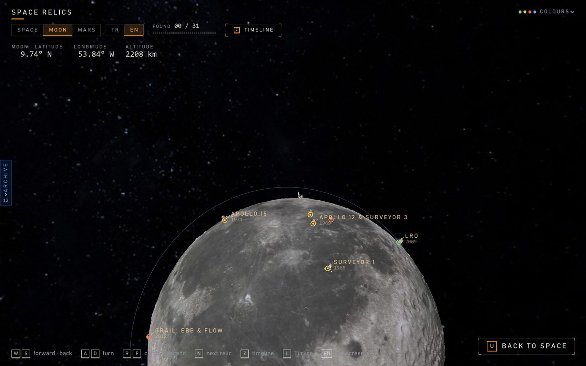
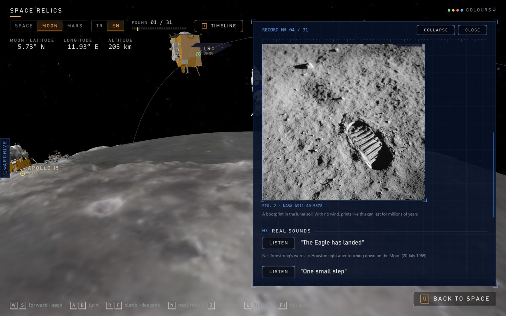

# Space Relics

**Find the spacecraft humanity left behind on the Moon, on Mars and in deep space.**

Space Relics is a desktop app made for the **NASA Space Apps Challenge 2026** (Denizli, Türkiye), challenge **"Abandoned but Not Forgotten"**, by **Team Kuzgun Aerospace**.

 **Website:** https://kuzgunaerospace.github.io/space-relics/
 **Download:** [Latest release](https://github.com/kuzgunaerospace/space-relics/releases/latest) (Windows 10/11)

---

## What it is

Thirty-one spacecraft finished their missions and are still out there: Apollo descent stages, silent rovers on Mars, probes leaving the solar system. Space Relics treats them as relics, not debris.

You fly a rocket through the solar system, land on the Moon and Mars, and search for them yourself. When you find one, you open its record: what it was for, what it found, what is left of it today, with NASA's own photographs and recordings.

| | |
|---|---|
| **31 spacecraft** | 12 on the Moon, 12 on Mars, 7 in deep space |
| **Real locations** | Each spacecraft sits at its published latitude and longitude |
| **Real terrain** | Moon and Mars surfaces built from NASA laser altimetry (LRO LOLA, MGS MOLA) |
| **Archive records** | Story, findings, what remains, 3D model, photos and sources |
| **47 photos, 7 recordings** | From NASA, including "The Eagle has landed" |
| **Timeline** | Replay 1962 to today and watch each spacecraft arrive |
| **Live distance** | Deep-space probes move in real time; Voyager 1 countdown to one light-day |
| **Two languages** | English and Turkish |

## Download and run

1. Download `SpaceRelics-Windows.zip` from [Releases](https://github.com/kuzgunaerospace/space-relics/releases/latest).
2. Unzip it and open `SpaceRelics.exe`. No installation and no internet connection needed.
3. If Windows shows a warning, choose **More info → Run anyway**. The app is not code-signed.

**Requirements:** Windows 10 or 11, 64-bit, about 130 MB of disk space.

## Controls

| Key | Action |
|---|---|
| `Enter` | Launch from the opening screen |
| `W` `A` `S` `D` / arrows | Fly and turn |
| `R` / `F` | Climb / descend (on the Moon and Mars) |
| `E` | Land on the Moon or Mars when close |
| `U` | Back to space |
| `N` | Autopilot to the next spacecraft |
| `0`–`9` | Autopilot to the Sun and planets (in space) |
| `Z` | Timeline |
| `L` | Switch language (English / Turkish) |
| `F11` | Full screen |
| `Esc` | Close photo, close record, quit |
| Mouse | Drag to look around, wheel to zoom, click a marker or the archive list |

## Status colours

| Colour | Meaning |
|---|---|
| 🟢 Green | Still working |
| 🟡 Yellow | Silent |
| 🔴 Red | Crashed or lost |
| 🔵 Blue | Left behind on purpose, or leaving the solar system |

## Honest simplifications

- **Distances are compressed** on a logarithmic scale so Voyager 1 and Mars fit on the same screen. Directions and order are correct; the numbers shown in km and AU are real.
- **Heights on the Moon and Mars are exaggerated 4×** so the terrain is visible.
- **Planet orbits are treated as circles.**
- **Orbiter paths around the Moon and Mars are illustrative.**
- The Voyager 1 starting distance is calibrated so our simple model matches NASA's announced one-light-day moment (18 November 2026, 06:16 UTC).

## Built with

- **C++17** and **[raylib 5.5](https://github.com/raysan5/raylib)**, built with **CMake** and **Visual Studio**
- **Blender** for 3D models, **Krita** for technical drawings
- All assets (data, photos, models, sounds, terrain) are embedded in a single `.exe`

## Data and credits

- **NASA mission pages:** locations, dates and stories
- **[NASA Image and Video Library](https://images.nasa.gov):** 47 photographs
- **[NASA 3D Resources](https://science.nasa.gov/3d-resources/):** spacecraft models
- **NASA audio archive:** 7 recordings (Apollo 11, Voyager, Cassini, Perseverance)
- **[LRO LOLA](https://pds-geosciences.wustl.edu/lro/lro-l-lola-3-rdr-v1/lrolol_1xxx/data/lola_gdr/cylindrical/img/)** and **[MGS MOLA](https://pds-geosciences.wustl.edu/mgs/mgs-m-mola-5-megdr-l3-v1/mgsl_300x/meg004/)** elevation data, NASA Planetary Data System
- **[Solar System Scope](https://www.solarsystemscope.com/textures/):** planet textures, licensed under CC BY 4.0
- **Our own work:** Some spacecrafts modeled in Blender, inspired by NASA photos

Space Relics is a student project. It is not affiliated with or endorsed by NASA.

## Use of AI

We used an AI assistant (Claude, developed by Anthropic) to help with code optimization and the placement of 3D models, as well as for language translation. The concept, the selection of the spacecraft, research and data validation, technical drawings, and the 3D models we created ourselves are all our own work. We planned, tested, and reviewed every step.

## Team Kuzgun Aerospace

- **Efe Dağdeviren:** software, interface, technical drawings
- **Belinay Nur Öner:** research, data, 3D modelling

---

## Türkçe

**Uzay Hatıraları**, Ay'da, Mars'ta ve derin uzayda görevini tamamlayıp orada kalan 31 uzay aracını bulmanı sağlayan bir masaüstü uygulaması. NASA Space Apps Challenge 2026 Denizli için **Kuzgun Aerospace** ekibi tarafından yapıldı.

Roketle Güneş Sistemi'nde uçuyor, Ay'a ve Mars'a iniyor ve araçları kendin arıyorsun. Bir aracı bulunca kaydını açıyorsun. Kayıtta aracın ne için gönderildiği, ne bulduğu ve bugün ondan geriye ne kaldığı yazıyor; NASA'nın gerçek fotoğrafları ve ses kayıtları da var. Uygulama Türkçe ve İngilizce; dil `L` tuşuyla değişiyor.

**İndirmek için:** [Releases](https://github.com/kuzgunaerospace/space-relics/releases/latest) sayfasından zip'i indir, çıkar ve `SpaceRelics.exe`'yi aç. Windows uyarı verirse **Ek bilgi → Yine de çalıştır**'a bas.
